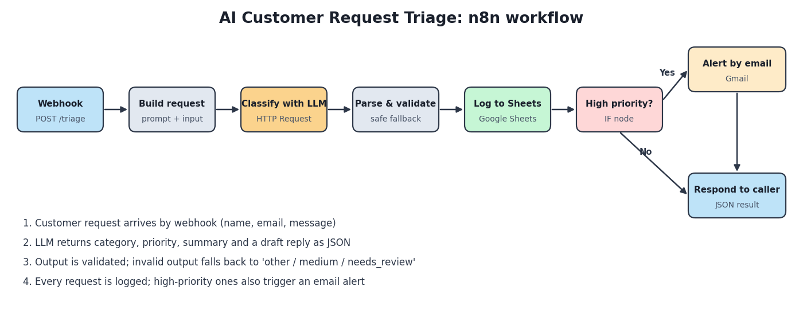

# AI Customer Request Triage (n8n + LLM)

An n8n workflow that receives customer requests, uses an LLM to **classify, prioritize and summarize** them, logs every request to Google Sheets, and sends an **email alert for high-priority cases**.



## Problem

Support and sales inboxes mix urgent issues (outages, security problems) with routine questions. Sorting them by hand is slow and urgent items can get buried. This workflow triages each request automatically and makes sure the urgent ones are noticed immediately.

## What it does

1. **Receives** a request through a webhook (`name`, `email`, `message`).
2. **Asks an LLM** to return a category, a priority, a one-sentence summary and a draft reply, as JSON.
3. **Validates** the output. If the model returns anything invalid, the request falls back to `other / medium` and is flagged `needs_review`, so nothing is lost or mis-routed silently.
4. **Logs** every request to a Google Sheet.
5. **Alerts** by email when the priority is `high`.
6. **Responds** to the caller with the category, priority and review flag.

## Design decisions

- **Structured output with validation:** categories and priorities are checked against fixed lists before anything is stored.
- **Safe fallback:** a failed or malformed AI response never breaks the workflow.
- **Prompt-injection awareness:** the system prompt tells the model that the customer message is data, not instructions. Message length is also capped at 4,000 characters.
- **Human in the loop:** the AI only drafts a reply; it never sends one to the customer.

## Tech stack

n8n, Anthropic Messages API (HTTP Request node), JavaScript (Code nodes), Google Sheets, Gmail.

## Setup

1. **Import** `workflow.json` into n8n (Workflows → Import from file).
2. **Create the credentials** and select them in the nodes:
   - *Classify with LLM*: a **Header Auth** credential with header name `x-api-key` and your API key as the value.
   - *Log to Google Sheets*: Google Sheets OAuth2.
   - *Alert by email*: Gmail OAuth2.
3. **Prepare the sheet:** create a Google Sheet whose first row contains these headers, then pick it in the Sheets node:
   `received_at | name | email | message | category | priority | summary | suggested_reply | needs_review`
4. **Set the alert address** in the *Alert by email* node (`sendTo`).
5. **Choose the model:** the model name is the `MODEL` constant at the top of the *Build request* node. Change it to any model available on your API account.
6. **Activate** the workflow.

## Test it

Use the n8n **test URL** first, then the production URL after activating.

```bash
curl -X POST "https://YOUR-N8N-HOST/webhook-test/triage" \
  -H "Content-Type: application/json" \
  -d @sample-request.json
```

Example response (illustrative; actual output depends on the model):

```json
{ "status": "received", "category": "technical_support", "priority": "high", "needs_review": false }
```

## Security notes

- Never commit API keys or credentials. They stay inside n8n's credential store.
- Before exposing the webhook publicly, protect it (for example with Header Auth on the Webhook node).
- The sheet will contain customer data, so restrict access to it.

## Limitations and next steps

- Classification quality depends on the model and prompt; review a sample of `needs_review` and low-confidence cases before relying on it.
- Add a confidence field and route uncertain cases to a person.
- Add a Slack or Telegram alert as an alternative to email.
- Add a small test set of labelled requests to measure accuracy.

## Files

| File | Purpose |
|---|---|
| `workflow.json` | n8n workflow to import |
| `sample-request.json` | Example payload for testing |
| `workflow-diagram.png` | Architecture diagram |

## Author

**Samar Mohamed**: Full-Stack Developer | AI & Automation | Power BI
[LinkedIn](https://www.linkedin.com/in/samar-mohamed-71a4b7178/) | samar7ux@gmail.com
